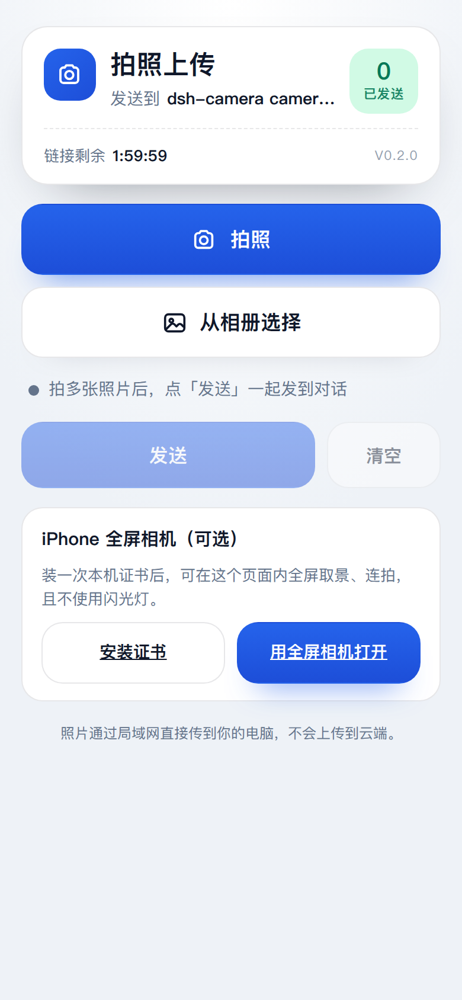
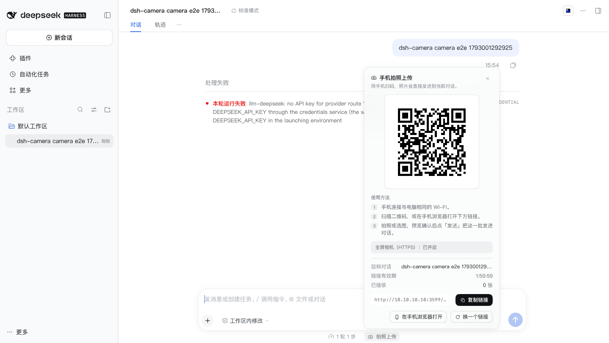
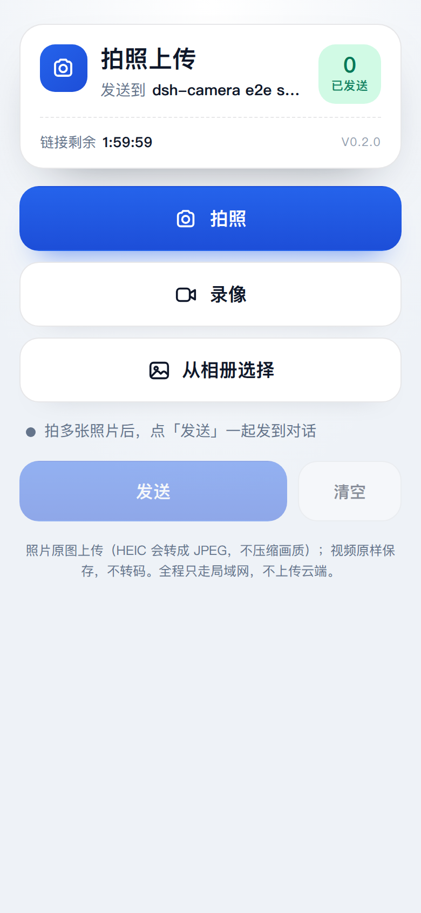
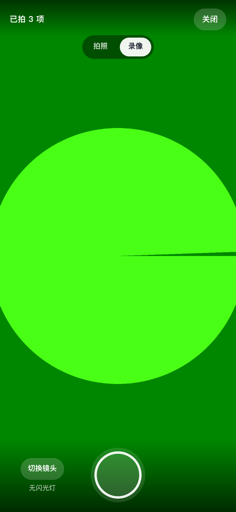
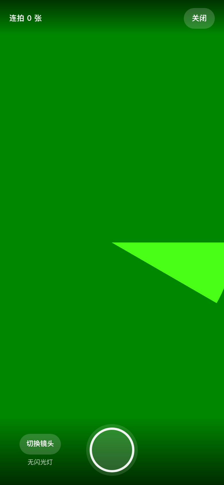
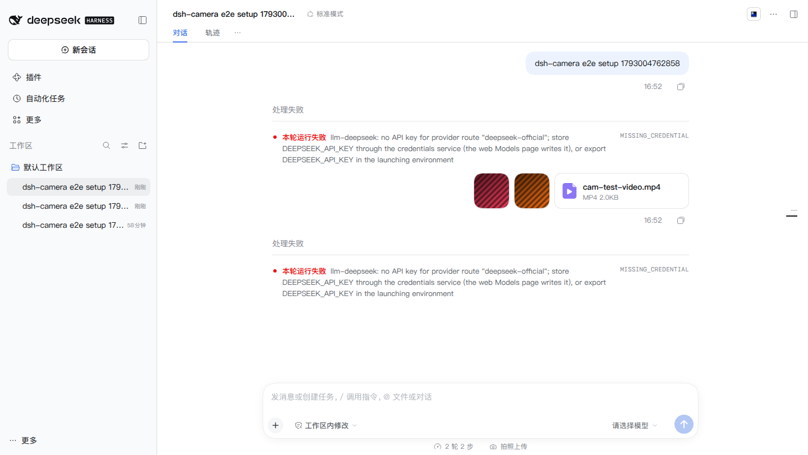

# dsh-camera — 手机扫码拍照，直传当前对话

> DSH Web 插件：在电脑上打开某个对话 → 点输入框下方的「拍照上传」→ 手机扫二维码打开一个局域网网页 → 拍照 / 从相册选图 → 图片**直接作为该对话的一条 user 消息**出现（带图片附件），模型立刻能看图回答。手机不用装 App、不用登录 DSH、不用把图先传到电脑。

Take photos with your phone over the LAN and drop them straight into the current DSH conversation —
no app, no DSH login on the phone, no cloud upload. Photos are staged locally, you review them,
then tap **Send** to deliver the batch as one message.

- 插件包名：`@local/dsh-camera`（DSH 本地/外部插件；可用 GitHub 安装）
- 适用：DSH `0.2.1-rc.3`，Web profile（`dsh web`）
- 依赖：无第三方运行时依赖；纯 Node 内置模块 + 内联浏览器代码（二维码生成器已 MIT 内联）
- 许可：MIT

## 功能

| 能力 | 说明 |
|---|---|
| 一键生成入口 | 输入框下方「拍照上传」按钮，点击即生成二维码 + 链接，绑定**当前对话** |
| 手机拍照 | 手机浏览器打开链接后：拍照（可连拍）、或从相册多选 |
| 视频 | 系统相机录像（HTTP 模式）或页面内全屏录像（HTTPS 模式，可带声音），和照片一起发送 |
| 原图直传 | 照片**不压缩**：保留原始字节与分辨率（仅 HEIC 会转成 JPEG，因为 DSH 不支持 HEIC）；视频原样保存、不转码 |
| 全屏相机 · 无闪光灯 | 可选 HTTPS 模式：在页面内全屏取景、连拍，不触发闪光灯/补光（iPhone 也可用；首次需装一次本机证书） |
| 上传进度 | 手机页显示发送进度（XHR upload progress），大图也有反馈 |
| 拍完手动发送 | 可连续拍照/录像/选图，先预览，点「发送 N 项」才一起发进对话（不自动发送） |
| HEIC 兼容 | iOS 相册 HEIC 由浏览器解码后转成 JPEG（全分辨率，不缩放），失败才提示 |
| 直接进对话 | 每次上传成为该对话的一条 user 消息（多图合成一条），不经过中转文件夹 |
| 安全 | 链接含 24 字符随机 token、默认 2 小时过期、仅当前对话可注入、仅局域网接口、每 token 限流；服务器只提供拍照页，不暴露 DSH 本体 |
| 中英双语 | 电脑面板与手机页都跟随中文/英文环境 |
| 可配置 | 端口、绑定地址、局域网 IP 覆盖、有效期、上传大小/数量/频率 |

## 架构

```
┌─────────────────────────┐         ┌──────────────────────────────┐
│ DSH Web GUI (loopback)  │         │  手机浏览器（同一 Wi-Fi）      │
│                         │         │                              │
│ composer dock  📷 拍照  │  RPC    │  GET /c/<token>  拍照页        │
│   └─ 面板：二维码/链接  │◄───────►│  POST /c/<token>/upload       │
└───────────┬─────────────┘         └──────────────┬───────────────┘
            │ /dsh-camera (cookie 鉴权)             │ http://<LAN-IP>:3579
            ▼                                       ▼
     ┌──────────────────────────────────────────────────┐
     │  Host 半（dsh-camera 插件，运行在 dsh web 进程内）  │
     │  · TokenStore：token → 目标 session + 过期时间      │
     │  · 独立 node:http 服务器（0.0.0.0:3579，只服务拍照页）│
     │  · injector：ctx.sessionController.prompt(...)     │
     │      → 图片归一化 + 落盘 + user 消息入队 + 唤醒模型 │
     └──────────────────────────────────────────────────┘
```

- **两个 HTTP 面**：DSH 自己的 Web 服务器只监听回环（`dsh web` 不允许 0.0.0.0），所以插件另起一个只服务「拍照页」的 LAN 服务器；DSH 的 RPC 面板接口仍走原有 loopback Web 服务器，用浏览器 cookie 鉴权。
- **注入方式**：Host 直接调用 `ctx.sessionController.prompt({sessionId, requestId, mode:'queue', content:[{type:'image', ...}]})` —— 与 Web 输入框发图走同一条 Host admission：模型多模态校验、EXIF 归一化、附件持久化、会话事件、唤醒 agent 全部由 DSH 负责。
- **token 绑定对话**：电脑面板打开时调用 `camera.arm`，把当前 `sessionId`（以及对话标题）写进 token store；手机上传只接受有效 token，图片只会进入被绑定的那个对话。

## 安装

从 GitHub 安装（推荐）：

```sh
# 1) 安装到 web profile
dsh plugin --profile web add 'github:ilovecnxx/dsh-camera'

# 2) 确认插件行进入组合
dsh --profile web --dump-config | grep -A2 dsh-camera
```

或者克隆后本地 link 安装（开发用）：

```sh
git clone https://github.com/ilovecnxx/dsh-camera.git
dsh plugin --profile web add link:$PWD/dsh-camera
```

3) 让运行中的 `dsh web` 生效：DSH 的 profile 热加载（`dsh-hmr`）会自动重组插件树；
   若面板未出现，刷新浏览器页面；仍未出现则重启 `dsh web`。

> 插件失败不会拖垮 GUI：profile 中未列入 required 的插件失败只会记录诊断，Web 界面照常可用。

## 使用

1. 在任意对话里，点输入框下方的 **📷 拍照上传**。
2. 面板出现二维码（也可点「复制链接」发给手机）。
3. 手机连**同一个 Wi-Fi**，扫码打开网页（首次会提示「此站点不安全」为正常，因为是局域网 HTTP）。
4. 拍照、**录像**或从相册选图/视频（相册按钮同时接受照片和视频）→ 内容先进入待发送预览
   （可继续拍/录、可删/重试）→ 确认后点「发送 N 项」；照片保持原图，视频原样保存。
   成功后电脑上对话里立刻出现一条消息：照片显示为图片，视频显示为文件卡片（见下方说明）。
5. 链接默认 2 小时有效；面板可「换一个链接」立即作废旧链接，或关闭面板后链接自然过期。

## 配置

`cordis.patch.yml` 的配置行（可选字段都有默认值，只写需要改的）：

```yaml
- insert:
    - id: dsh-camera
      name: '@local/dsh-camera'
      config:
        port: 3579              # 手机页端口；0 表示随机（被占用时会自动回退随机端口）
        lanIpOverride: ''       # 手动指定局域网 IP（多网卡/自动探测错误时用）
        tokenTtlMs: 7200000     # 手机链接有效期（毫秒，默认 2h）
        maxUploadBytes: 100663296 # 单次上传请求上限（默认 96 MiB，照片/视频合计）
        maxImageBytes: 20971520  # 单张照片上限（默认 20 MiB，DSH 附件硬限制；不压缩只校验）
        maxVideoBytes: 83886080  # 单个视频上限（默认 80 MiB，原样保存）
        maxRecordSeconds: 60     # 页面内录像最长秒数（默认 60s，仅 HTTPS 全屏相机）
        maxFilesPerUpload: 6    # 一次最多几项（照片+视频）
        uploadsPerHour: 120     # 每个 token 每小时上传次数上限
        https: false            # 可选：开启 HTTPS 全屏相机（iPhone 用，见下）
        httpsPort: 0            # HTTPS 端口；0 = HTTP 端口 + 1
```

环境变量覆盖（便于临时排障）：

| 变量 | 作用 |
|---|---|
| `DSH_CAMERA_PORT` | 覆盖端口 |
| `DSH_CAMERA_LAN_IP` | 覆盖局域网 IP |
| `DSH_CAMERA_DEBUG=1` | 打开插件调试日志（Host 日志前缀 `dsh-camera`） |

## iPhone 全屏相机（HTTPS，可选）

iOS Safari 只在 **HTTPS（受信任证书）** 下允许网页直接调用相机。默认的 HTTP 模式用的是系统相机
（能拍照，但不是页面内全屏，也无法关闭系统闪光灯）。想要页面内全屏、连拍、无闪光灯：

1. 在插件配置里开启 `https: true`（重启或热加载后生效）。
2. 电脑面板会出现「全屏相机（HTTPS）：已开启」；手机重新打开拍照页。
3. 手机页会出现「iPhone 全屏相机」提示（见下图），点 **安装证书**：



   - iPhone：下载描述文件 → 设置 → 已下载描述文件 → 安装 → 通用 → 关于本机 → 证书信任设置 → 信任 `dsh-camera local CA`；
   - Android：下载 `.crt` → 设置 → 安全 → 加密与凭据 → 安装证书 → CA 证书。
4. 回到拍照页点 **用全屏相机打开**（https://<LAN-IP>:<httpsPort>/c/<token>）；
   页面内可以「拍照」连拍，也可以切到「录像」录视频（需要麦克风权限；默认最长 60 秒），
   **不会调用闪光灯**。

- 证书在本机 `$DSH_HOME/dsh-camera/tls/` 生成（本地 CA + 服务器证书），只覆盖局域网地址；
- 安装页：`http://<LAN-IP>:<HTTP 端口>/setup`，证书下载：`/ca.mobileconfig`（iPhone）、`/ca.crt`（Android）；
- 不需要全屏相机时保持 `https: false` 即可，功能不受影响。

## 安全说明

- **仅局域网**：手机页服务器绑定 `0.0.0.0`，端口只提供「拍照上传页」与上传接口，不代理 DSH、不提供文件浏览。
- **不可猜测链接**：token 为 24 字符 CSPRNG base64url（144 bit 熵），绑定对话、带有效期；泄露一条链接只能往那一个对话发图。
- **不做 DNS rebinding 面**：拍照页不含任何跨站请求；上传必须带正确 token；页面带严格 CSP。
- **模型限制**：目标对话当前模型若不支持图片输入（例如纯文本模型），上传会被拒绝并在手机页提示切换视觉模型。
- **原图与视频落盘**：照片保持原图（HEIC 会先转成 JPEG），视频原样保存为文件附件，均存到 `$DSH_HOME` 下（不可变附件，不自动删除）。
- **视频对模型是文件**：DSH 只有图片能进入模型视觉输入；视频以「文件附件」进入对话，模型收到文件名、大小和可读取的保存路径，不会直接“观看”视频内容。对话界面里显示为文件卡片。
- **不经过公网**：插件不开启任何隧道；需要在外面用请配合 dsh-pocket 等方案自行评估风险。

## 故障排查

| 现象 | 处理 |
|---|---|
| 面板提示「服务未启动」 | 看 Host 日志 `dsh-camera` 前缀；通常是端口被占用（会自动回退并提示 warning）或插件未加载 |
| 面板提示「未检测到局域网地址」 | 电脑没有连 Wi-Fi/网线，或网卡 IP 非私网段；用 `lanIpOverride` 手动指定 |
| 手机打不开链接 | 确认手机和电脑在同一 Wi-Fi、电脑防火墙放行该端口（如 `ufw allow 3579/tcp`）、链接未过期 |
| 手机页上传报「模型不支持图片」 | 切换到支持视觉的模型后重新上传 |
| 上传报「链接已过期」 | 在电脑上重新打开面板生成新链接 |
| 面板二维码显示但 URL 是 127.0.0.1 | 未检测到 LAN IP，回退本地地址；设置 `lanIpOverride` |
| 视频发不出去 / 提示「视频太大」 | 单视频上限默认 80 MiB：录短一点，或用相册选小一点的视频；也可调大 `maxVideoBytes`/`maxUploadBytes` |
| 录的视频没有声音 | 系统/浏览器拒绝了麦克风权限；在 设置 → Safari → 麦克风 里允许后重试 |
| 视频在对话里只显示文件卡片 | 正常：DSH 不支持视频视觉输入，视频按文件附件保存（模型可拿路径/文件名，不能直接“看”） |
| 照片被提示超过 20 MB | DSH 附件硬上限；不要用 ProRAW/超高像素原图，或先在相册里导出普通 JPEG |
| HEIC 转 JPEG 失败 | 该 HEIC 编码浏览器无法解码；在 iPhone 相册里「编辑 → 存储」导出 JPEG，或直接用系统相机拍照（JPEG） |

## 截图

电脑端入口与二维码面板（开启 HTTPS 后会多一行「全屏相机（HTTPS）：已开启」）：



手机页：拍照 / 录像 / 从相册选择；照片保持原图，视频原样保存：



拍完先进入待发送预览（照片 + 视频），点「发送 N 项」才上传（不自动发送）：



可选 HTTPS 全屏相机：首次装一次本机证书，之后页面内全屏取景、连拍、录像，**无闪光灯**：



手机发出的照片与视频进入 DSH 对话（照片为图片消息，视频为文件附件）：



## 开发与测试

```sh
cd dsh-camera
node --test                  # 单元测试（零外部依赖）：178 项，174 pass / 3 skipped / 1 todo / 0 fail
node scripts/e2e.mjs         # HTTP 手动发送全链路 E2E（隔离 profile + headless Chrome）
node scripts/e2e-camera.mjs  # HTTPS 全屏相机 E2E（Chrome fake camera + secure-context 覆盖）
```

本次 E2E 结果（2026-10-26，v0.2.0）：

- **HTTP E2E PASS（10.6s，14/14 步）**：面板二维码 → 手机页选 2 图 + 1 视频（不自动上传，upload 请求 0）→
  手动「发送 3 项」→ 桌面计数 3 → GUI 图片 + 视频文件卡片 → 会话日志确认 image block 与 file block；
- **全屏相机 E2E PASS（12.3s）**：开启 HTTPS 后 HTTP 页显示「iPhone 全屏相机」引导 →
  页面内全屏取景 → 连拍 2 张 + 录像 1 段进入待发送（上传请求 0）→ 手动发送 → 对话/日志（图片+视频文件）校验通过。

隔离验证（不污染真实 profile）：

```sh
export DSH_HOME=/tmp/dsh-cam-home
mkdir -p "$DSH_HOME/profiles/cam"
# profiles/cam/package.json: dsh.profile.bundles = [dsh-base, dsh-web-app, @local/dsh-camera]
dsh plugin --profile cam add link:$PWD
dsh --profile cam --no-open --port 3099   # 日志里拿 ?token= 的地址
```

设计细节与模块契约见 [DESIGN.md](./DESIGN.md)。

## 文件

| 文件 | 作用 |
|---|---|
| `index.js` | Host 入口：装配配置 / token / LAN 服务器 / 注入器 / RPC，卸载清理 |
| `lib/config.js` | 配置解析与校验 |
| `lib/tokens.js` | token → 对话绑定、过期、限流、持久化 |
| `lib/lan-ip.js` | 局域网 IPv4 探测 |
| `lib/multipart.js` | multipart/form-data 与 raw image 解析、图片类型嗅探 |
| `lib/server.js` | 手机页 HTTP 服务器（页面/info/upload） |
| `lib/page.js` | 手机拍照页（单文件 HTML+CSS+JS） |
| `lib/inject.js` | 图片 → 对话 user 消息注入 |
| `lib/rpc.js` | 面板 RPC 通道 `/dsh-camera` |
| `lib/qr.js` + `lib/vendor/qrcode.cjs` | 二维码生成（内联 MIT 库） |
| `client.js` | 浏览器半：输入框下方入口 + 二维码/状态面板 |

## 许可

MIT。内联二维码生成器来自 `qrcode-generator@1.4.4`（MIT，Copyright (c) 2009 Kazuhiko Arase），
见 `lib/vendor/LICENSE-qrcode-generator.txt`。

[](https://github.com/deepseek-ai/deepseek-harness)
